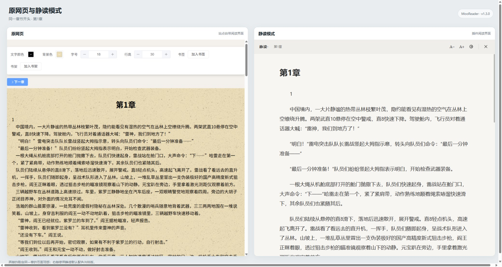

# MooReader · 静读

为 [jinghecx.com 阅读页](https://jinghecx.com/responsive/read?cbid=3730797403908001&ccid=10014783077636248) 提供简洁的 Chrome 阅读模式。支持该站的嵌入式阅读框和直接显示正文的页面，可调整字号、行距、段落间距、正文宽度、字体及配色。原网页有注释或“下一章”按钮时，阅读模式也会保留相应操作。

## 安装

1. 在仓库页面点击绿色 **Code** 按钮，选择 **Download ZIP**，然后解压下载的文件。
2. 在 Chrome 地址栏输入 `chrome://extensions/` 并按回车。
3. 打开页面**右上角的“开发者模式”开关**。
4. 点击**“加载已解压的扩展程序”**，选择解压后文件夹里的 **`extension` 文件夹**（从 GitHub 下载时通常在 `MooReader-main/extension`）。选中的文件夹内应能看到 `manifest.json`。
5. 打开阅读页，等正文出现后，点击浏览器工具栏的“静读”图标。若图标未显示，先点击拼图形状的扩展菜单，再点“静读”；可以在菜单中将它固定到工具栏。

已经安装旧版时，请用新版 `extension` 文件夹里的文件覆盖原安装文件夹，然后在 `chrome://extensions/` 点击“静读”卡片上的刷新按钮，并刷新阅读页。阅读偏好会保留。

## 使用

- 点击工具栏的 **A− / A+** 调整字号；点击设置图标调整排版和颜色。
- 点击正文中的“注”查看注释；再次点击或按 `Esc` 收起。
- 按 `Esc` 退出阅读模式。

扩展只整理网站已经在当前浏览器显示的章节。偏好设置保存在浏览器本地，章节内容不会发送到扩展作者的服务器。网站若更改页面结构，正文提取规则可能需要更新。

